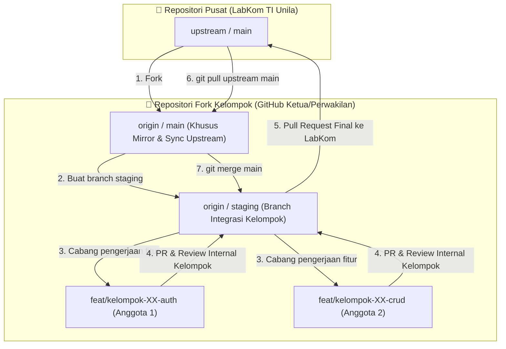

# 🔥 FINAL PROJECT (TUGAS BESAR)
## Praktikum Pemrograman Web 2026 — Teknik Informatika Universitas Lampung

Selamat datang di repositori pusat **Tugas Besar Praktikum Pemrograman Web** Laboratorium Komputer Teknik Informatika Universitas Lampung (`Praktikum-LabKom-TI-Unila`). Repositori ini menggunakan arsitektur terpusat (*monorepo*) yang dilengkapi dengan sistem otomatisasi **CI/CD (GitHub Actions)** untuk memvalidasi setiap pengumpulan kode dari masing-masing kelompok.

---

## 📌 Daftar Tema Sistem (8 Tema Fakultas)
Setiap kelompok wajib membangun **1 (satu) sistem secara *native*** (HTML, CSS, JavaScript, PHP Native, dan MySQL/MariaDB tanpa *framework* backend) berdasarkan salah satu dari 8 tema fakultas di bawah ini.

> ⚠️ **Aturan Pemilihan Tema:**
> 1. **Batas Kuota:** Setiap tema fakultas **maksimal hanya dapat dipilih oleh 4 (empat) kelompok**.
> 2. **Relevansi Sistem:** Sistem yang dibangun wajib berkaitan langsung dengan bidang keilmuan, layanan, atau operasional dari fakultas yang dipilih (misalnya: jika memilih **Fakultas Kedokteran**, maka sistem wajib berkaitan dengan layanan kesehatan, rekam medis, klinik, atau apotek).
> 3. **Koordinasi Pemilihan:** Pemilihan tema dilakukan melalui koordinasi bersama Asisten Praktikum (mekanisme *first-come, first-served* sesuai ketentuan asisten).

| Kode | Tema Fakultas | Deskripsi Ruang Lingkup Sistem | Kuota |
| :---: | :--- | :--- | :---: |
| **01** | **Fakultas Teknik** | Sistem yang berkaitan dengan rekayasa teknologi dan keteknikan, seperti manajemen proyek konstruksi/infrastruktur, pemantauan energi/kelistrikan, inventaris alat & manajemen laboratorium teknik, sistem keselamatan kerja (K3), bengkel permesinan, perancangan tata ruang/arsitektur, atau monitoring perangkat industri. | Maks. 4 Kelompok |
| **02** | **Fakultas FEB (Ekonomi & Bisnis)** | Sistem yang berkaitan dengan sektor ekonomi, tata kelola keuangan, dan bisnis, seperti pencatatan akuntansi & pembukuan, sistem kasir (*point of sale* / POS), manajemen persediaan/gudang, koperasi mahasiswa/karyawan, perencanaan anggaran, sistem pembiayaan/investasi mikro, atau analisis performa penjualan. | Maks. 4 Kelompok |
| **03** | **Fakultas FISIP (Ilmu Sosial & Ilmu Politik)** | Sistem yang berkaitan dengan tata kelola sosial, kepemerintahan, dan komunikasi publik, seperti layanan administrasi kependudukan/birokrasi desa/kampus, portal pengaduan & aspirasi publik, sistem *e-voting* atau jajak pendapat, kehumasan (*public relations*), portal media pers/jurnalistik kampus, atau pengelolaan organisasi sosial. | Maks. 4 Kelompok |
| **04** | **Fakultas Hukum** | Sistem yang berkaitan dengan regulasi hukum, administrasi peradilan, dan layanan legalitas, seperti sistem bantuan hukum (LBH), pencatatan rekam perkara/kasus pidana & perdata, repositori arsip peraturan perundang-undangan & regulasi kampus, penjadwalan persidangan semu (*moot court*), konsultasi hukum online, atau manajemen perizinan kontrak. | Maks. 4 Kelompok |
| **05** | **Fakultas FKIP (Keguruan & Ilmu Pendidikan)** | Sistem yang berkaitan dengan dunia pendidikan, administrasi akademik sekolah/kampus, dan proses belajar-mengajar, seperti *Learning Management System* (LMS) sederhana, presensi & penilaian rapor digital, bimbingan konseling (BK), penjadwalan guru/dosen mengajar, evaluasi kurikulum, atau portal pelatihan tenaga pendidik. | Maks. 4 Kelompok |
| **06** | **Fakultas Kedokteran** | Sistem yang berkaitan dengan layanan medis, fasilitas kesehatan, dan manajemen pasien, seperti pendaftaran antrean pasien klinik/RS, rekam medis elektronik (*electronic health record*), penjadwalan dokter/tenaga medis, manajemen stok obat & resep apotek, reservasi konsultasi medis, atau sistem informasi donor darah. | Maks. 4 Kelompok |
| **07** | **Fakultas MIPA (Matematika & Ilmu Pengetahuan Alam)** | Sistem yang berkaitan dengan sains murni, komputasi saintifik, dan pengelolaan laboratorium, seperti sistem peminjaman instrumen & inventaris bahan kimia laboratorium, pencatatan limbah penelitian B3, pemantauan stasiun cuaca & kualitas lingkungan, pengolahan/visualisasi data riset saintifik, atau reservasi observatorium astronomi. | Maks. 4 Kelompok |
| **08** | **Fakultas Pertanian** | Sistem yang berkaitan dengan agribisnis, pemanfaatan sumber daya hayati, dan ketahanan pangan, seperti pencatatan siklus panen & budidaya tanaman pangan/hortikultura, manajemen perkebunan, pencatatan hasil ternak & budidaya perikanan, inventaris pupuk dan bibit, logistik distribusi hasil tani, atau monitoring kesuburan lahan pertanian. | Maks. 4 Kelompok |

---

## 📂 Struktur Direktori Repositori
Seluruh kelompok bekerja di dalam direktori `kelompok/` pada folder kelompoknya masing-masing. **Dilarang keras** mengubah file di luar folder kelompok sendiri.

```text
TUBES_PRK_PEMWEB_2026/
├── .github/
│   ├── workflows/
│   │   └── pr-validation.yml       # Robot CI/CD (JANGAN DIUBAH)
│   └── pull_request_template.md    # Template PR (JANGAN DIUBAH)
├── kelompok/
│   ├── README.md                   # Petunjuk direktori kelompok (JANGAN DIUBAH)
│   ├── kelompok_01/                # Folder khusus Kelompok 01
│   │   ├── assets/
│   │   ├── config/
│   │   ├── database/               # Simpan file .sql di sini
│   │   ├── index.php
│   │   └── README.md               # Dokumentasi sistem Kelompok 01
│   ├── kelompok_02/                # Folder khusus Kelompok 02
│   └── ...
├── .gitignore
└── README.md                       # Dokumentasi utama (JANGAN DIUBAH)
```

---

## 🚀 Panduan Setup & Alur Kerja Kolaborasi (Best Practice)

Untuk memudahkan kolaborasi multi-anggota di dalam satu kelompok tanpa saling menimpa kode, repositori ini merekomendasikan penggunaan **Branch `staging` sebagai branch integrasi internal kelompok** sebelum diajukan ke repositori utama LabKom:



---

### Langkah-Langkah Pengerjaan:

### 1. Fork Repositori & Undang Anggota Kelompok
1. Buka repositori utama: `https://github.com/Praktikum-LabKom-TI-Unila/TUBES_PRK_PEMWEB_2026`
2. Perwakilan kelompok (Ketua) klik tombol **Fork** di pojok kanan atas.
3. Di repositori hasil *fork*, buka menu **Settings** > **Collaborators** > klik **Add people**, lalu tambahkan akun GitHub seluruh anggota kelompok agar semuanya memiliki akses *push*.

### 2. Clone Repositori Fork ke Komputer Lokal
Seluruh anggota kelompok membuka Terminal / Git Bash di folder `www` Laragon atau `htdocs` XAMPP masing-masing:
```bash
git clone https://github.com/<username-ketua>/TUBES_PRK_PEMWEB_2026.git
cd TUBES_PRK_PEMWEB_2026
```

### 3. Tambahkan Remote `upstream` (Wajib untuk Semua Anggota)
Hubungkan repositori lokal Anda langsung dengan repositori utama LabKom:
```bash
git remote add upstream https://github.com/Praktikum-LabKom-TI-Unila/TUBES_PRK_PEMWEB_2026.git
git remote -v
```

### 4. Setup Branch Integrasi Kelompok (`staging`)
1. **Ketua Kelompok** membuat branch `staging` dari `main` dan mengunggahnya ke GitHub fork:
   ```bash
   git checkout main
   git checkout -b staging
   git push -u origin staging
   ```
2. **Anggota Kelompok Lainnya** cukup mengambil branch tersebut ke lokal masing-masing:
   ```bash
   git fetch origin
   git checkout staging
   ```

### 5. Pengerjaan Fitur Masing-Masing Anggota
Setiap anggota membuat branch fitur spesifik yang dicabangkan dari **`staging`**:
```bash
# Pastikan berada di staging dan sudah versi terbaru
git checkout staging
git pull origin staging

# Buat branch fitur baru
git checkout -b feat/kelompok-01-autentikasi
```

Kerjakan kode **hanya di dalam folder `kelompok/kelompok_XX/`**:
- ✅ **Format folder:** `kelompok/kelompok_01/`, `kelompok/kelompok_02/`, dst. (huruf kecil semua, 2 digit angka).
- Lakukan commit dan push ke repo fork kelompok:
  ```bash
  git status
  git add kelompok/kelompok_01/
  git commit -m "feat(kelompok_01): menyelesaikan halaman login dan session"
  git push origin feat/kelompok-01-autentikasi
  ```

### 6. Review Internal Kelompok (PR ke Branch `staging`)
1. Buka repo fork di GitHub, buat Pull Request dari branch fitur Anda menuju branch **`staging`** di repo fork kelompok Anda sendiri.
2. Rekan sekelompok memeriksa kode dan melakukan *Merge* ke `staging`.
3. Seluruh anggota melakukan `git pull origin staging` untuk menguji aplikasi secara utuh di server lokal masing-masing (memastikan tidak ada error PHP dan database sinkron).

### 7. Lakukan Pull Request (PR) Final ke Repositori Utama LabKom
Setelah sistem di branch `staging` sudah lengkap, stabil, dan dites lolos di lokal:
1. Buka repositori fork di GitHub, lalu klik **Compare & pull request**.
2. Atur arah PR dengan tepat:
   - **base repository:** `Praktikum-LabKom-TI-Unila/TUBES_PRK_PEMWEB_2026` (branch: `main`)
   - **head repository:** `<username-ketua>/TUBES_PRK_PEMWEB_2026` (branch: `staging`)
3. Isi deskripsi PR sesuai *template* yang telah disediakan dan kirimkan PR.
4. Bot CI/CD akan otomatis memvalidasi folder isolasi, ukuran file (maks. 5MB), dan sintaks PHP.

---

## 🔄 Cara Sinkronisasi Repo Setelah PR Di-Merge oleh Asisten
Setelah Pull Request kelompok Anda disetujui dan di-*merge* ke `main` LabKom oleh Asisten, lakukan sinkronisasi berikut:
```bash
# 1. Perbarui branch main lokal dari repositori LabKom
git checkout main
git pull upstream main
git push origin main

# 2. Sinkronkan branch staging agar sejajar dengan main terbaru
git checkout staging
git merge main
git push origin staging
```

---

## 🤖 Aturan Validasi Otomatis (CI/CD Rules)
Setiap Pull Request yang masuk akan diperiksa secara otomatis oleh **GitHub Actions**. Tombol **Merge** akan terkunci otomatis apabila PR Anda melanggar salah satu dari 4 aturan berikut:

1. **Isolasi Direktori Ketat:**
   - PR **hanya boleh** berisi perubahan di dalam folder `kelompok/kelompok_XX/` milik kelompok Anda sendiri.
   - Mengubah file di *root* (`README.md`, `.gitignore`), folder `.github/`, atau `kelompok/README.md` akan membuat CI/CD **Gagal (❌)**.
2. **Satu PR = Satu Kelompok:**
   - Satu Pull Request tidak boleh menyentuh lebih dari satu folder `kelompok_XX` sekaligus.
3. **Batas Ukuran File (Maksimal 5 MB):**
   - Dilarang mengunggah file berukuran lebih dari **5 MB** per file (seperti video mentah, file `.zip` / `.rar`, atau *installer*).
4. **Bebas *Syntax Error* PHP (`PHP Linter`):**
   - Seluruh file `.php` yang Anda unggah akan diuji menggunakan *PHP 8.2 Linter* (`php -l`). Jika terdapat kesalahan sintaks (seperti kurang titik koma `;` atau kurung kurawal `{}` tidak tertutup), PR akan **ditolak otomatis**.

---

## 📞 Bantuan & Kendala Teknis
Jika mengalami kendala terkait *merge conflict* atau kegagalan CI/CD yang tidak dapat diselesaikan, silakan hubungi **Asisten Praktikum Pemrograman Web** dengan menyertakan tautan (*link*) Pull Request kelompok Anda.